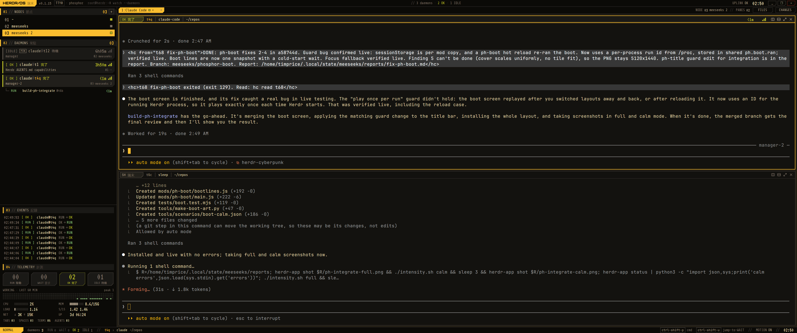

# PHOSPHOR

Herdr as a 1980s mainframe console that happens to run your agents: gruvbox dark with an amber phosphor accent,
every element worded like a boot-log line (`[ RUN ]`, `[WAIT]`, `[ OK ]`), set in machined cut-corner plates.
The chrome gets a faint glow; the terminals stay dark and readable, with barely visible scanlines behind them.
A blocked agent turns the title bar into a red strip you can see from across the room, and one key (`ctrl-shift-u`)
jumps to it. Only RUN and WAIT things move; idle is still. `./intensity.sh calm` takes the motion, glow and
scanlines out without losing any information. Built for a 5120x1440 ultrawide, works down to about 900 px.

## What you see

Top to bottom. Colours (each has one meaning): void `#0b0a07`, pane `#12110e`, panel `#1a1916` / `#211f1b`,
line `#3c3836`, grey `#504945`, dim `#7c6f64`, dim2 `#a89984`, chrome fg `#ebdbb2`, terminal fg `#e6d3a8`.
**Amber `#fabd2f` = you are here** (logo, active node, active tab, focused pane, NORMAL plate) and nothing else.
Aqua `#8ec07c` = working `[ RUN ]` 稼働, red `#fb4934` = blocked `[WAIT]` 要求, green `#b8bb26` = done `[ OK ]` 完了,
dim = idle `[IDLE]` 待機, dim2 = plain shell `[ SH ]` 端末, orange `#fe8019` = the THINKING label only.
Fonts: Share Tech Mono (chrome), VT323 (numbers, clock), "PH Wordmark" (Orbitron Black, renamed; wordmark only),
Kosugi Maru subset (kanji), JetBrains Mono (terminals, tags, arrows, key caps).

- **Title bar, 24 px** (`ph-title`, draggable, `titlebar: "none"`). Left: amber cut-corner plate `HERDR/OS 端末`, the app
  version in VT323, a `TTY0 · phosphor` tag and a dim echo `root@herdr:~# watch --daemons`. Centre: while nothing is
  blocked, `// N daemons · n RUN · n WAIT · n OK · n IDLE` in the state colours; while something is blocked, a red strip
  `▲ 要求 N DAEMON NEEDS YOU // prog@addr · space · title … ctrl-shift-u RESPOND ›` with hazard-stripe bands at both
  ends. Right: `UPLINK OK` (from machines; `SYNC`, or `N DOWN` in red), a VT323 `HH:MM` clock in fg, and on Linux the
  window buttons as cut-corner outlines.
- **Sidebar, 420 px** (min 44, max 720, background void), two blocks:
  - `ph-side` (fills): `01 // NODES 節点`: one row per space, index in VT323, name, `git:branch ↑ahead ↓behind`, one pip
    per agent in the state colour; the active space is an inverse amber plate; worktree spaces nest under their checkout
    (`├─` / `└─`); a `+` in the header. `02 // DAEMONS 常駐`: two-line rows sorted WAIT > OK > RUN > IDLE > SH, pinned
    first: tag plate, `prog@addr` (amber when focused), kanji, minutes in state (`<1m`, `3m`, `1h04m`, `2d03h`), 3-bar
    signal; line two the agent's title (with a `█` cursor on RUN) and its home node. Sub-agents (hc children) appear as
    indented tree rows. A blocked row has a hazard edge, red tint and red outline. Below 160 px wide it becomes a
    one-line-per-agent rail.
  - `ph-telemetry` (440 px): `03 // EVENTS 記録`, a log of status changes `HH:MM:SS [TAG] prog@addr OLD → NEW`
    (shown only when the block is tall enough), then `04 // TELEMETRY 計測`: four cut-corner counter plates
    (RUN / WAIT / OK / IDLE, VT323, grey at zero, WAIT tinted red), a `WORKING · LAST 60 MIN` cell histogram with
    `peak N`, host CPU % / MEM used/total / LOAD 1·5·15 with neutral gauges, NET ↓rx ↑tx, UP uptime, and a footer
    `TABS / SPACES / TERMS / AGENTS`.
- **Work column.**
  - Tab bar, 26 px (`ph-tabs`, draggable): `1:build` tabs, the active one an amber cut-corner plate, inactive ones line
    outlines, blocked ones a red outline; a status square per tab. Right: `NODE 01 name // git:branch // PANES nn`
    and `FILES` / `CHANGES` outlined buttons (amber outline when open).
  - Panes (`{"tab":"active"}`, 6 px padding and gaps, square corners, 1 px `#504945` border, 2 px amber when focused).
    Each pane has a 26 px header on top (`ph-pane`): a cut-corner status plate (tag + kanji), `addr │ prog │ cwd │
    git:branch` (cwd elides first, then branch), `THINKING` (focused RUN) or `NEEDS YOU · ctrl-shift-u` (WAIT), minutes
    in state in VT323, signal bars, split-right / split-down / zoom / close. The focused pane gets an amber address and a
    stacked-stroke glow rule under the header; a blocked pane gets a red rule. Mod panes show a neutral `MOD 拡張` plate.
  - The Files / Changes panel (shipped `files` and `changes` mods), hidden by default, 368 px.
- **Status line, 22 px** (`ph-status`): amber `NORMAL` plate, `daemons N`, `RUN n WAIT n OK n IDLE n`, then
  `// addr › prog  ~/cwd  git:branch ↑a ↓b +dirty  @machine`; right: key caps `ctrl-shift-p cmd` and
  `ctrl-shift-u jump-to-WAIT` (red while anything waits), `// MOTION ON|CALM // HH:MM`.
- **Background**: a 5120x1440 PNG of faint amber rows every 3 px on `#12110e`, seen through terminals at
  `terminal_opacity: 0.7` (about 9% see-through) and raw in the 6 px gutters, which reads as a CRT frame.
- **Toasts** (`ph-toast`): `[WAIT] claude@t4q.service needs input 要求` + title + `[ctrl-shift-u] jump to pane · space › tab`
  on a red plate with a glow outline and a blinking hazard band; `[ OK ] Finished claude@t12.service 完了` on green.
- **Boot overlay** (`ph-boot`), once per app run: a full-window boot log built from real data (layout, mods, fonts,
  node/tab/terminal counts, daemons by program, a red `[WAIT]` line per blocked agent, /proc telemetry) with a 40-cell bar.

## How it behaves

- **Working (RUN):** aqua tag; signal bars and the `█` cursor animate in the sidebar; the focused RUN pane's header bars
  animate and it says THINKING. Unfocused RUN panes are still.
- **Blocked (WAIT):** red everywhere it appears; the title strip appears; hazard plates blink (opacity, 700 ms) in the
  sidebar, the tab marker, the focused pane plate and the toast band; unfocused pane plates are static stripes at 0.6.
  Sorts to the top of DAEMONS. A WAIT toast pops once.
- **Done (OK):** still green plate; an OK toast types in (width, 350 ms) once.
- **Idle / shell:** dim, flat bars, nothing moves, nothing ticks.
- **Clocks:** minute resolution everywhere (`HH:MM`, `3m`); redraws aligned to the wall-clock minute, only where a
  RUN/WAIT readout is on screen. EVENTS rows carry seconds as a timestamp, but nothing ticks per second.
- **Respond, `ctrl-shift-u`** (section `layout:phosphor`, command `ph-kit.respond`): focuses the agent that has been
  blocked longest. Clicking the title strip, the status line's WAIT count or a WAIT toast does the same.
- **Clicks:** NODES row selects the space, right-click opens the space menu, drag reorders, `+` makes a space;
  DAEMONS row focuses the agent (a pane-less sub-agent is peeked), right-click pins/unpins; tabs: click selects, drag
  moves, double-click renames, right-click menu, middle-click / `×` closes, wheel cycles; pane header buttons split,
  zoom, close; `cmd` key cap opens the palette; FILES / CHANGES toggle the panel.
- **Calm (`./intensity.sh calm`):** no scanlines (root background `canvas`, `terminal_opacity` 1, pane frame back to
  `background`), glow reduced to its 1 px core, hazard stripes become solid red plates, cursor solid, bars static, no
  blinking, toasts just appear, no boot overlay, the status line reads `MOTION CALM`. Same information.
- No sound anywhere.

## Built from

- `layouts/phosphor.json`: root `column`, theme `phosphor`, `titlebar: "none"`, `toast: "ph-toast"`, font JetBrains Mono,
  ui_font Share Tech Mono, `background: {image: "backgrounds/phosphor-scanlines.png", fit: "cover"}`,
  `terminal_opacity: 0.7`. Children: `title` (24 px, ph-title) · `body` row [`sidebar` column (420 px) [`side`
  (weight, ph-side), `telemetry` (440 px, ph-telemetry)], `work` column [`tabs` (26 px, ph-tabs), `work-body` row
  [`main` `{"tab":"active"}` with a pane frame (`background: "#12110e00"`, header ph-pane 26 px top always), `panel`
  (hidden) stack `files` / `changes`]]] · `statusline` row (22 px) [`status` (ph-status), `kit` (0 px, ph-kit)].
  Every ph-* node has `props.intensity` (`full` | `calm`); `intensity.sh` rewrites those and the three scanline keys.
- `themes/phosphor.json`: background `#12110e`, foreground `#e6d3a8`, gruvbox ANSI, cursor amber; accent `#fabd2f`,
  canvas / chrome `#0b0a07`, border `#3c3836`.
- `lib/` (copied into every mod by `tools/sync-lib.sh`): `palette.js` (colours, fonts, state tags/kanji, urgency
  order), `geom.js` + `plate.js` (cut-corner plates, outlines, hazard stripes via `Background.pattern_slash`,
  stacked-stroke glow via `paint_path`), `motion.js` (intensity from props, else `shared("ph.intensity")`; `blink`,
  `cursor`, `bars` that drop their loops in calm), `since.js` (time-in-state tracker).
- Mods: `ph-kit` (invisible; fonts, mirrors props.intensity to `shared("ph.intensity")`, the `respond` command via
  `nextCommand()` → `agent.focus`), `ph-title`, `ph-tabs`, `ph-side`, `ph-telemetry`, `ph-pane`, `ph-status`,
  `ph-toast`, `ph-boot`. Shipped mods used: `files`, `changes`, `menu` (space/tab menus).
- herdr: `agents`, `terminals`, `panes`, `spaces`, `focused`, `machines`, `keys`, `layout`, `settings`, `updates`,
  `props`, `shared`/`setShared`, `run`, `openOverlay`/`closeOverlay`; commands `agent.focus`, `terminal.peek`,
  `terminal.pin`, `space.select/new/move`, `tab.select/move/rename/close/next/prev`, `pane.focus/split/zoom/close`,
  `layout.show/hide/select` (the panel), `app.palette`.
- Programs: `git` (ph-side: branch and ahead/behind per space, at most once a minute while the window is in front;
  ph-status: `git status --porcelain=v2 --branch` in the focused cwd, on that space's machine). ph-telemetry reads
  `/proc/{stat,meminfo,net/dev,loadavg,uptime}` every 5 s (falls back to `sh -c cat` if the file read fails). No network.
- Art: `backgrounds/phosphor-scanlines.png` and `mods/ph-boot/wordmark-glow.png` (from `tools/make-boot-art.py`);
  pane button icons; fonts in `mods/ph-kit/fonts` (OFL / Apache, licences there).

## Watch out

- `on_size_change` reports zoomed px; `.w()` takes logical px. Divide by `settings().zoom` (or by measured / layout px).
- `line_height(n)` is a multiplier; use `"18px"` for pixels.
- Herdr has no per-agent timestamp. Track status changes yourself, persist them, and never forget an address just
  because one render (e.g. the first after a restart) didn't list it; drop only after 30 days absent.
- Scanlines are invisible behind an opaque pane frame: the `main` pane frame background must be transparent, and calm
  must set it back to `background` or the frame shows `canvas`. Dark texture rows vanish under `terminal_opacity`
  (see-through ≈ (1−op)² in linear light): use faint bright rows.
- No per-second redraws: minute clocks only; motion is native `loop()`s on RUN/WAIT elements, not re-renders.
  ph-telemetry polls every 5 s but only calls `notify` when a shown string changes, and skips while hidden.
- The boot guard is per app run (`sessionStorage`); ph-title opens the overlay (`kind: "window"`, 1x1 at 0,0 covers
  the window) and skips it in calm.
- Orbitron's licence reserves its name: the modified instance must be renamed (here "PH Wordmark").
- A mod can't import from another folder: shared code is copied per mod, and `check.sh` fails if a copy is stale.
- Limits: EVENTS keeps 60 rows; the histogram covers 60 minutes; the sidebar below about 160 px shows a rail without
  telemetry detail; the title strip truncates names under about 900 px.

## Done when

- `./check.sh` passes: lib copies in sync, node tests, JSON valid, `herdr-app check` on lib and every mod.
- `herdr-app do layout.switch '{"name":"phosphor"}'` loads it and `herdr-app status` shows `errors: []`, with no
  `*.error` files under `mods/`.
- A blocked agent shows the red title strip, sorts first in DAEMONS, and `ctrl-shift-u` focuses it.
- `./intensity.sh calm` removes scanlines, blinking and loops (status line says `MOTION CALM`); `./intensity.sh full`
  brings them back.
- With every agent idle, nothing on screen moves and the only redraws are once a minute.
